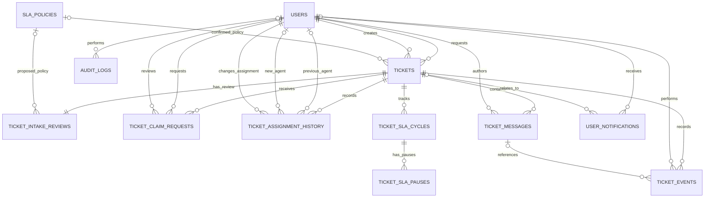

# 04 — Data Model

## 1. Purpose and Design Principles

This document defines the relational data model for the Helpdesk & SLA Ticketing System MVP. It translates the business rules in `01-project-scope.md`, `02-roles-and-permissions.md`, and `03-workflow-and-sla.md` into entities, relationships, constraints, and transaction requirements.

The database must represent the complete ticket lifecycle:

1. A Customer submits a ticket and proposes a Priority and SLA targets.
2. The ticket waits for Admin intake review. Normal processing and SLA tracking have not started.
3. The Admin accepts, adjusts and accepts, or rejects the ticket.
4. Once accepted, the ticket becomes eligible for assignment and processing SLA tracking starts.
5. An Agent can request an unassigned ticket, but cannot process it until the Admin approves the request and the assignment is persisted.
6. An Admin can also assign or reassign a ticket directly.
7. Authorized staff process the ticket, communicate with the Customer, and update its status through valid transitions.
8. The system records ticket events, SLA cycles, SLA pause intervals, in-app notifications, and administrative audit records.

### 1.1 Database and application assumptions

- Database: MySQL 8.x with InnoDB.
- ORM and migrations: Prisma.
- Application: Node.js, Express 5, and TypeScript.
- IDs: `BIGINT UNSIGNED` primary keys, unless the implementation standardizes on another ID format before migrations are created.
- Timestamps: use `DATETIME(3)` and store UTC values consistently. Convert to the user's local time only at the presentation layer.
- The MVP uses one workspace. There is no `workspaces`, `organizations`, or `tenants` table.
- A `users` record has one primary role in the MVP: `CUSTOMER`, `AGENT`, or `ADMIN`.
- Email delivery, file attachments, Redis, background queues, WebSockets, and external integrations are out of scope.
- Database relationships do not replace authorization checks. The backend must enforce role, ticket ownership, assignment, workflow, and data-visibility rules.

### 1.2 Core modeling principles

**Separate intake from processing.** A ticket can be pending review or rejected without having entered normal processing. Intake status and processing status must not be treated as one field.

**Preserve proposals and confirmed values.** The Customer's proposed Priority and SLA targets must not be overwritten when Admin confirms or adjusts them.

**Keep current state and history distinct.** The `tickets` row represents current operational state; history tables preserve important changes without overwriting earlier events.

**Snapshot SLA targets.** Each accepted ticket keeps the target-minute values confirmed for that ticket. Later changes to a company SLA policy must not silently change existing ticket deadlines.

**Record related changes atomically.** A successful critical workflow operation must update the affected business records and create the corresponding history records in the same database transaction.

---

## 2. Entity Overview

The MVP contains 12 core tables.

| Table                       | Purpose                                                                                                        |
| --------------------------- | -------------------------------------------------------------------------------------------------------------- |
| `users`                     | Stores Customer, Agent, and Admin accounts.                                                                    |
| `sla_policies`              | Stores the company-approved combinations of First Response and Resolution SLA targets available for selection. |
| `tickets`                   | Stores each ticket's identity, requester, current processing state, and current assignment.                    |
| `ticket_intake_reviews`     | Preserves the original proposal and records Admin's intake-review details.                                     |
| `ticket_claim_requests`     | Stores Agent requests to take an accepted, unassigned ticket.                                                  |
| `ticket_assignment_history` | Records every assignment, reassignment, and unassignment.                                                      |
| `ticket_messages`           | Stores public replies and internal notes.                                                                      |
| `ticket_sla_cycles`         | Stores First Response and Resolution SLA tracking cycles.                                                      |
| `ticket_sla_pauses`         | Stores each Resolution SLA pause and resume interval.                                                          |
| `ticket_events`             | Stores the ticket timeline and ticket-level business events.                                                   |
| `user_notifications`        | Stores in-app notifications for individual recipients.                                                         |
| `audit_logs`                | Records administrative changes to system-wide data, such as users and SLA policies.                            |

These tables have different responsibilities. In particular, claim requests are not assignments, ticket events are not message content, and in-app notifications are not the authoritative record of a business decision.

---

## 3. Entity-Relationship Diagram

The diagram below shows the primary relationships. Each table is detailed in the following sections.

**Notation:** `||` means exactly one, `o|` means zero or one, and `o{` means zero or many.

Additional foreign keys, ownership constraints, uniqueness rules, and transaction requirements are specified below. The diagram intentionally does not show every foreign key to keep the main workflow readable.

---

## 4. Table Definitions

The fields below describe the logical database design. Exact Prisma types, database defaults, and migration syntax should be finalized when implementation begins.

### 4.1 `users`

Stores all authenticated accounts.

| Field           | Type / Rule                      | Description                                         |
| --------------- | -------------------------------- | --------------------------------------------------- |
| `id`            | `BIGINT UNSIGNED`, PK            | Internal user identifier.                           |
| `full_name`     | `VARCHAR(150)`, required         | Display name.                                       |
| `email`         | `VARCHAR(254)`, required, unique | Login email; normalize consistently before storage. |
| `password_hash` | `VARCHAR(255)`, required         | Password hash, never the plain-text password.       |
| `role`          | Enum, required                   | `CUSTOMER`, `AGENT`, or `ADMIN`.                    |
| `status`        | Enum, required                   | `ACTIVE` or `INACTIVE`.                             |
| `created_at`    | `DATETIME(3)`, required          | Account creation timestamp.                         |
| `updated_at`    | `DATETIME(3)`, required          | Last account update timestamp.                      |

**Relationships**

- One user can request many tickets.
- One user can create many tickets.
- One user can author many messages.
- One user can submit or review many claim requests, subject to role restrictions.
- One user can perform many assignment changes and ticket events.
- One user can receive many notifications.
- One user can perform many administrative audit actions.

**Rules**

- Role and account status must be checked by the backend on every protected operation.
- Only authorized Admins can manage user roles.
- An inactive Agent cannot receive a new assignment or claim a ticket.
- Historical references to a user should normally be preserved. Do not cascade-delete user records that are referenced by ticket history.
- The database can enforce the role enum, but the backend must enforce rules such as “the requester must be a Customer” and “the assigned user must be an eligible Agent.”

**Why no separate `roles` table?**

The MVP has three fixed roles and each account has one primary role. A separate `roles` and `user_roles` design would introduce unnecessary many-to-many complexity. A `role` enum is sufficient for the current scope. A separate role-permission model can be introduced later if permissions become configurable.

---

### 4.2 `sla_policies`

Stores the company-approved SLA target combinations available to Customers when proposing values.

| Field                           | Type / Rule                | Description                           |
| ------------------------------- | -------------------------- | ------------------------------------- |
| `id`                            | `BIGINT UNSIGNED`, PK      | Policy identifier.                    |
| `name`                          | `VARCHAR(120)`, required   | Human-readable policy name.           |
| `first_response_target_minutes` | Positive integer, required | First Response SLA target in minutes. |
| `resolution_target_minutes`     | Positive integer, required | Resolution SLA target in minutes.     |
| `status`                        | Enum, required             | `ACTIVE` or `INACTIVE`.               |
| `created_by_user_id`            | FK → `users.id`, required  | Admin who created the policy.         |
| `updated_by_user_id`            | FK → `users.id`, required  | Admin who last updated the policy.    |
| `created_at`                    | `DATETIME(3)`, required    | Creation timestamp.                   |
| `updated_at`                    | `DATETIME(3)`, required    | Last update timestamp.                |

**Relationships**

- A policy may be proposed in many intake reviews.
- A policy may be confirmed for many accepted tickets.

**Rules**

- Target values must be positive integers and must fit within the supported business range.
- Only Admins can create, update, activate, or deactivate policies.
- Customers can only propose an active, supported policy.
- Deactivating a policy must not remove it or invalidate references from existing records.
- Existing tickets must retain their confirmed target-minute snapshots even if the corresponding policy is later changed or deactivated.

**Why is Priority not a field in this table?**

Priority and SLA targets are distinct concepts. A policy defines a supported combination of time targets; Priority is separately proposed and confirmed during intake. This avoids assuming that Priority alone determines SLA targets unless the business explicitly introduces that rule later.

---

### 4.3 `tickets`

Stores the ticket's current operational state. This is the central business entity.

| Field                           | Type / Rule                      | Description                                                             |
| ------------------------------- | -------------------------------- | ----------------------------------------------------------------------- |
| `id`                            | `BIGINT UNSIGNED`, PK            | Internal ticket identifier.                                             |
| `requester_id`                  | FK → `users.id`, required        | User requesting support.                                                |
| `created_by_user_id`            | FK → `users.id`, required        | User who actually created the record.                                   |
| `subject`                       | `VARCHAR(200)`, required         | Short ticket subject.                                                   |
| `description`                   | `TEXT`, required                 | Problem description.                                                    |
| `intake_status`                 | Enum, required                   | `PENDING_REVIEW`, `ACCEPTED`, or `REJECTED`.                            |
| `processing_status`             | Enum, nullable                   | `OPEN`, `IN_PROGRESS`, `WAITING_FOR_CUSTOMER`, `RESOLVED`, or `CLOSED`. |
| `priority`                      | Enum, nullable                   | `LOW`, `MEDIUM`, `HIGH`, or `URGENT`; confirmed value only.             |
| `sla_policy_id`                 | FK → `sla_policies.id`, nullable | Confirmed SLA policy for an accepted ticket.                            |
| `first_response_target_minutes` | Positive integer, nullable       | Confirmed target snapshot for this ticket.                              |
| `resolution_target_minutes`     | Positive integer, nullable       | Confirmed target snapshot for this ticket.                              |
| `accepted_at`                   | `DATETIME(3)`, nullable          | Time the Admin accepted the ticket.                                     |
| `assigned_agent_id`             | FK → `users.id`, nullable        | Current assigned Agent, if any.                                         |
| `created_at`                    | `DATETIME(3)`, required          | Ticket creation timestamp.                                              |
| `updated_at`                    | `DATETIME(3)`, required          | Last ticket update timestamp.                                           |

**Relationships**

- Each ticket has one requester.
- Each ticket has one creator.
- Each ticket has exactly one intake-review record.
- Each ticket may have zero or one current assigned Agent.
- Each ticket may have many claim requests, assignment-history records, messages, SLA cycles, ticket events, and notifications.

**Why are `requester_id` and `created_by_user_id` separate?**

They answer two different questions:

- `requester_id`: who needs support and owns the Customer-facing ticket.
- `created_by_user_id`: who performed the creation action.

This supports accurate attribution and auditing if authorized staff are allowed to create a ticket on behalf of a requester. If a Customer creates their own ticket, the two values must be equal.

**Rules**

1. A new ticket starts with `intake_status = PENDING_REVIEW`.
2. While intake is pending, `processing_status`, `priority`, `sla_policy_id`, confirmed target snapshots, `accepted_at`, and `assigned_agent_id` must be null.
3. When intake is rejected, `processing_status` and all confirmed operational fields remain null. The ticket must not be assigned or processed.
4. When intake is accepted, set `intake_status = ACCEPTED`, `processing_status = OPEN`, and populate the confirmed Priority, policy, target snapshots, and `accepted_at` in one transaction.
5. An accepted ticket may remain unassigned. Assignment is a separate process from intake acceptance.
6. `assigned_agent_id` is the authoritative source for the current assignment. It must reference an eligible Agent.
7. If a ticket's assignee changes, update this field and create a `ticket_assignment_history` record in the same transaction.
8. A Customer cannot directly change `intake_status`, `processing_status`, `priority`, the current assignee, or the confirmed SLA targets.
9. Valid processing-status transitions are defined in `03-workflow-and-sla.md`; they must be enforced in the application service, not left to arbitrary client updates.
10. The `CLOSED` status is final in the MVP.

**Why is `processing_status` nullable?**

A ticket that is pending review or rejected has not entered normal processing. Assigning it `OPEN` at creation would falsely imply that processing and SLA tracking had started. Once intake is accepted, the initial processing status becomes `OPEN`.

**Cross-field constraint**

The relationship between `intake_status` and `processing_status` spans business rules and related records. Enforce it in a transactional service, with database constraints where supported. A simple enum or foreign key alone cannot guarantee these workflow rules.

---

### 4.4 `ticket_intake_reviews`

Stores the original Customer proposal and Admin's intake-review details. There must be exactly one row per ticket in the MVP.

| Field                                    | Type / Rule                         | Description                                      |
| ---------------------------------------- | ----------------------------------- | ------------------------------------------------ |
| `id`                                     | `BIGINT UNSIGNED`, PK               | Intake-review record identifier.                 |
| `ticket_id`                              | FK → `tickets.id`, required, unique | Ticket under review.                             |
| `proposed_priority`                      | Enum, required                      | Original proposed Priority.                      |
| `proposed_sla_policy_id`                 | FK → `sla_policies.id`, required    | Policy selected when proposing SLA targets.      |
| `proposed_first_response_target_minutes` | Positive integer, required          | Target-minute snapshot from the proposed policy. |
| `proposed_resolution_target_minutes`     | Positive integer, required          | Target-minute snapshot from the proposed policy. |
| `reviewed_by_user_id`                    | FK → `users.id`, nullable           | Admin who made the decision; null while pending. |
| `reviewed_at`                            | `DATETIME(3)`, nullable             | Decision timestamp; null while pending.          |
| `adjustment_reason`                      | `TEXT`, nullable                    | Explanation of changes to the proposed values.   |
| `rejection_reason`                       | `TEXT`, nullable                    | Mandatory explanation when intake is rejected.   |
| `created_at`                             | `DATETIME(3)`, required             | Record creation timestamp.                       |
| `updated_at`                             | `DATETIME(3)`, required             | Last review-record update timestamp.             |

The canonical intake status is stored in `tickets.intake_status`. This table stores the proposal and decision metadata rather than maintaining a second intake-status field.

**Relationships**

- Each ticket has exactly one intake-review record.
- Each review references the proposed SLA policy.
- The review may reference the Admin who decided the intake.

**Rules**

- Create the review row with the ticket, inside the same transaction.
- Copy the target-minute values from the selected policy at proposal time. Do not rely exclusively on a live join to the current policy values, because the policy may later change.
- The proposed values must never be replaced with the final confirmed values.
- On acceptance, populate the confirmed operational fields on `tickets`, record the Admin and decision timestamp, and preserve the proposal in this table.
- If the Admin changes Priority or SLA targets, `adjustment_reason` is mandatory and must explain the adjustment. The final values are stored on `tickets`; the related ticket event and notification must preserve the original proposal, final values, reason, and decision details.
- If the Admin rejects the ticket, `rejection_reason` is mandatory and the confirmed operational fields on `tickets` must remain null.
- Pending review must have no reviewer or decision timestamp.
- Accepted or rejected intake must have a reviewer and decision timestamp.
- In the MVP, the review is decided once. A future design that supports repeated formal review decisions should introduce an append-only decision-history entity rather than silently overwriting the original decision.

**Why is this a separate table?**

Intake is a business process with its own proposal data and decision metadata. Keeping it separate prevents operational ticket fields from erasing the original request and avoids mixing intake decisions with later processing-status changes.

---

### 4.5 `ticket_claim_requests`

Stores Agent requests to take an accepted, currently unassigned ticket.

| Field                 | Type / Rule                 | Description                                         |
| --------------------- | --------------------------- | --------------------------------------------------- |
| `id`                  | `BIGINT UNSIGNED`, PK       | Claim-request identifier.                           |
| `ticket_id`           | FK → `tickets.id`, required | Requested ticket.                                   |
| `agent_id`            | FK → `users.id`, required   | Agent who submitted the request.                    |
| `status`              | Enum, required              | `PENDING`, `APPROVED`, `REJECTED`, or `CANCELLED`.  |
| `requested_at`        | `DATETIME(3)`, required     | Request timestamp.                                  |
| `reviewed_by_user_id` | FK → `users.id`, nullable   | Admin who decided the request.                      |
| `reviewed_at`         | `DATETIME(3)`, nullable     | Decision timestamp.                                 |
| `decision_reason`     | `TEXT`, nullable            | Optional explanation for rejection or cancellation. |
| `created_at`          | `DATETIME(3)`, required     | Record creation timestamp.                          |
| `updated_at`          | `DATETIME(3)`, required     | Last status update timestamp.                       |

**Rules**

- A claim request is valid only for an accepted ticket with no current assigned Agent.
- Only an eligible Agent may submit a claim request.
- A `PENDING` claim request does not assign the ticket and does not grant processing permission.
- Only an Admin can approve or reject a pending request.
- On approval, the ticket's current assignee must be set to the requesting Agent, the claim request must become `APPROVED`, and assignment history must be created in the same transaction.
- If the ticket has already been assigned, a pending request must not be approved.
- When one claim request is approved or an Admin assigns the ticket directly, other pending requests that are no longer eligible must be cancelled consistently.
- A rejected or cancelled request remains in the database as history.
- A retry after a previous rejection or cancellation may create a new claim-request row.

**Why is this a separate table from `tickets`?**

A request to take ownership is not the same as actual ownership. Keeping these records separate prevents a pending request from being interpreted as an assignment and preserves the history of competing requests.

---

### 4.6 `ticket_assignment_history`

Records each effective assignment change. The current assignee remains stored on `tickets.assigned_agent_id`.

| Field                | Type / Rule                               | Description                                                                           |
| -------------------- | ----------------------------------------- | ------------------------------------------------------------------------------------- |
| `id`                 | `BIGINT UNSIGNED`, PK                     | Assignment-history identifier.                                                        |
| `ticket_id`          | FK → `tickets.id`, required               | Affected ticket.                                                                      |
| `previous_agent_id`  | FK → `users.id`, nullable                 | Agent assigned before the change; null when previously unassigned.                    |
| `new_agent_id`       | FK → `users.id`, nullable                 | Agent assigned after the change; null when unassigned.                                |
| `changed_by_user_id` | FK → `users.id`, required                 | User who performed the change.                                                        |
| `claim_request_id`   | FK → `ticket_claim_requests.id`, nullable | Approved claim request that caused this assignment, if applicable.                    |
| `source`             | Enum, required                            | `CLAIM_APPROVAL`, `ADMIN_DIRECT_ASSIGNMENT`, `ADMIN_REASSIGNMENT`, or `UNASSIGNMENT`. |
| `reason`             | `TEXT`, nullable                          | Optional operational explanation.                                                     |
| `changed_at`         | `DATETIME(3)`, required                   | Assignment-change timestamp.                                                          |

**Rules**

- Each effective assignment change creates a new history row. Do not overwrite prior assignment-history records.
- `tickets.assigned_agent_id` represents the current assignment; this table represents previous changes.
- Both the current-assignee update and the history insert must be committed atomically.
- `previous_agent_id` and `new_agent_id` must be different for an actual change.
- An unassignment has a null `new_agent_id` and source `UNASSIGNMENT`.
- `claim_request_id` is populated only when a claim approval is the source of the assignment.
- An assignment history entry must agree with the ticket's assignment before/after the corresponding change. The service must read and update the ticket in a transaction to avoid conflicting changes.

**Why not store the current assignment as another table?**

A separate current-assignment table is unnecessary for the MVP. The ticket needs one authoritative current assignee, and `tickets.assigned_agent_id` provides it. A separate history table preserves the audit trail without having to query and reconcile multiple “active assignment” records.

---

### 4.7 `ticket_messages`

Stores Customer-visible replies and staff-only internal notes.

| Field            | Type / Rule                 | Description                                           |
| ---------------- | --------------------------- | ----------------------------------------------------- |
| `id`             | `BIGINT UNSIGNED`, PK       | Message identifier.                                   |
| `ticket_id`      | FK → `tickets.id`, required | Related ticket.                                       |
| `author_user_id` | FK → `users.id`, required   | Message author.                                       |
| `visibility`     | Enum, required              | `PUBLIC` or `INTERNAL`.                               |
| `body`           | `TEXT`, required            | Message content.                                      |
| `created_at`     | `DATETIME(3)`, required     | Creation timestamp.                                   |
| `updated_at`     | `DATETIME(3)`, required     | Last edit timestamp, if message editing is permitted. |

**Rules**

- A public reply is visible to the Customer who owns the ticket and authorized staff.
- An internal note is visible only to authorized Agents and Admins.
- Customers cannot create internal notes.
- A Customer may add a public reply only to their own ticket and only when the workflow allows it. They cannot add a message to a `CLOSED` ticket.
- An Agent must be the currently assigned Agent to process the ticket or provide a reply that qualifies for the First Response SLA, according to the relevant workflow and permission rules.
- Public messages from Customers do not satisfy First Response SLA.
- Internal notes, status changes, assignment changes, and automated notifications do not satisfy First Response SLA.
- Message content should not be duplicated inside the ticket-event record. The event may reference the message.

**Why is this a separate table?**

Tickets can have many messages, and each message has its own author, visibility, content, and timestamp. Storing messages separately supports the public/internal visibility boundary and preserves the discussion history.

Attachments are excluded from the MVP. A future attachment feature can add a `ticket_attachments` table and file-storage references without changing the core ticket workflow.

---

### 4.8 `ticket_sla_cycles`

Stores SLA tracking for an accepted ticket. It distinguishes the one-time First Response SLA from the Resolution SLA, which may have multiple cycles if a resolved ticket is reopened.

| Field                   | Type / Rule                         | Description                                                       |
| ----------------------- | ----------------------------------- | ----------------------------------------------------------------- |
| `id`                    | `BIGINT UNSIGNED`, PK               | SLA-cycle identifier.                                             |
| `ticket_id`             | FK → `tickets.id`, required         | Related ticket.                                                   |
| `sla_type`              | Enum, required                      | `FIRST_RESPONSE` or `RESOLUTION`.                                 |
| `cycle_number`          | Positive integer, required          | Cycle sequence for that SLA type and ticket.                      |
| `target_minutes`        | Positive integer, required          | Target snapshot for this cycle.                                   |
| `started_at`            | `DATETIME(3)`, required             | SLA-cycle start timestamp.                                        |
| `due_at`                | `DATETIME(3)`, required             | Current calculated deadline, updated when a pause is resumed.     |
| `status`                | Enum, required                      | `ACTIVE`, `PAUSED`, `MET`, `BREACHED`, or `CANCELLED`.            |
| `completed_at`          | `DATETIME(3)`, nullable             | Time the SLA objective was satisfied.                             |
| `breached_at`           | `DATETIME(3)`, nullable             | First recorded time this deadline was breached, if applicable.    |
| `qualifying_message_id` | FK → `ticket_messages.id`, nullable | Public message that satisfied First Response SLA; otherwise null. |
| `created_at`            | `DATETIME(3)`, required             | Record creation timestamp.                                        |
| `updated_at`            | `DATETIME(3)`, required             | Last tracking update timestamp.                                   |

**Unique constraint**

`UNIQUE (ticket_id, sla_type, cycle_number)`

**Rules**

- Create SLA cycles only after the Admin accepts intake.
- Initial acceptance creates:
  - One `FIRST_RESPONSE` cycle with `cycle_number = 1`.
  - One `RESOLUTION` cycle with `cycle_number = 1`.
- Both cycles start at the accepted timestamp. The SLA target values are copied from the confirmed ticket target snapshots.
- First Response SLA is satisfied by the first qualifying public response from the currently assigned Agent, not by a Customer message or an internal note.
- Once First Response SLA is met, do not create another First Response cycle for the same ticket in the MVP.
- Resolution SLA is satisfied when the ticket becomes `RESOLVED`.
- If a `RESOLVED` ticket is reopened by a valid `RESOLVED → IN_PROGRESS` transition, preserve the previous cycle and create a new Resolution SLA cycle using the ticket's confirmed target snapshot.
- A `CLOSED` ticket cannot be reopened in the MVP.
- SLA cycles must not be created for rejected tickets.
- SLA deadlines use a 24/7 clock. The Resolution deadline is extended by completed pause intervals; while paused, the clock does not consume target time.
- The service must ensure that only the current Resolution cycle can be paused or resumed.
- `breached_at` preserves evidence that the SLA was breached even if the objective is later completed. A later completion must not erase the breach history.

**Why is this a separate table?**

SLA tracking is not just a static target on a ticket. The system must calculate deadlines, record whether an objective was met or breached, retain pause history, and support a new Resolution SLA cycle after reopening. Storing only `first_response_due_at` and `resolution_due_at` directly on the ticket would make cycle history difficult to represent reliably.

---

### 4.9 `ticket_sla_pauses`

Stores each pause/resume interval for the Resolution SLA.

| Field          | Type / Rule                           | Description                                           |
| -------------- | ------------------------------------- | ----------------------------------------------------- |
| `id`           | `BIGINT UNSIGNED`, PK                 | Pause-interval identifier.                            |
| `sla_cycle_id` | FK → `ticket_sla_cycles.id`, required | Resolution SLA cycle being paused.                    |
| `paused_at`    | `DATETIME(3)`, required               | Pause start timestamp.                                |
| `resumed_at`   | `DATETIME(3)`, nullable               | Resume timestamp; null while the pause is still open. |
| `created_at`   | `DATETIME(3)`, required               | Record creation timestamp.                            |
| `updated_at`   | `DATETIME(3)`, required               | Last interval update timestamp.                       |

**Rules**

- Only a `RESOLUTION` SLA cycle may have pause intervals.
- Entering `WAITING_FOR_CUSTOMER` creates a pause interval for the current Resolution cycle.
- Leaving `WAITING_FOR_CUSTOMER` for `IN_PROGRESS` closes the open pause interval and extends the cycle deadline by the elapsed pause duration.
- Transitioning from `WAITING_FOR_CUSTOMER` directly to `RESOLVED` also closes the open interval before completing the Resolution SLA cycle.
- A pause interval must not resume before it starts.
- Only one unclosed pause interval may exist for a given active Resolution SLA cycle.
- A pause must never be applied to the First Response SLA.
- Reopening a resolved ticket creates a new Resolution SLA cycle; it must not reuse a completed cycle or reopen its old pause intervals.

The “only one unclosed pause interval” rule spans rows. Enforce it with a transaction and appropriate locking in the service, along with any practical database constraints supported by the selected schema.

**Why is this a separate table?**

A ticket may wait for the Customer more than once. A single `resolution_sla_paused_at` field cannot preserve all historical pause intervals, which are necessary to recalculate deadlines and explain SLA results.

---

### 4.10 `ticket_events`

Stores ticket-level business events and the timeline shown to authorized users.

| Field                | Type / Rule                         | Description                                                       |
| -------------------- | ----------------------------------- | ----------------------------------------------------------------- |
| `id`                 | `BIGINT UNSIGNED`, PK               | Event identifier.                                                 |
| `ticket_id`          | FK → `tickets.id`, required         | Ticket affected by the event.                                     |
| `actor_user_id`      | FK → `users.id`, nullable           | User who performed the action; null for a system-generated event. |
| `event_type`         | Enum or controlled string, required | Business event identifier.                                        |
| `visibility`         | Enum, required                      | `CUSTOMER_VISIBLE` or `STAFF_ONLY`.                               |
| `related_message_id` | FK → `ticket_messages.id`, nullable | Message associated with the event, if any.                        |
| `before_data`        | JSON, nullable                      | Relevant state before the action.                                 |
| `after_data`         | JSON, nullable                      | Relevant state after the action.                                  |
| `metadata`           | JSON, nullable                      | Additional structured context.                                    |
| `created_at`         | `DATETIME(3)`, required             | Event timestamp.                                                  |

Suggested event types include:

- `TICKET_CREATED`
- `INTAKE_ACCEPTED`
- `INTAKE_REJECTED`
- `INTAKE_ADJUSTED`
- `CLAIM_REQUESTED`
- `CLAIM_APPROVED`
- `CLAIM_REJECTED`
- `CLAIM_CANCELLED`
- `TICKET_ASSIGNED`
- `TICKET_REASSIGNED`
- `TICKET_UNASSIGNED`
- `STATUS_CHANGED`
- `PRIORITY_CHANGED`
- `PUBLIC_REPLY_ADDED`
- `INTERNAL_NOTE_ADDED`
- `SLA_PAUSED`
- `SLA_RESUMED`
- `SLA_BREACHED`
- `TICKET_RESOLVED`
- `TICKET_REOPENED`
- `TICKET_CLOSED`

The enum or controlled list must be implemented consistently across services and tests.

**Rules**

- Create the corresponding event in the same transaction as a successful critical ticket operation, whenever applicable.
- Ticket events are append-only in normal operation. Do not rewrite historical events to make an earlier state appear different.
- Do not store passwords, password hashes, secrets, or unnecessary personal information in JSON metadata.
- `CUSTOMER_VISIBLE` events must contain only information permitted for the ticket's requester. Never expose internal notes or staff-only operational metadata through a public timeline.
- The visibility of an event is independent from message visibility: the message remains the authoritative content record; the event records the fact that the message was added.
- Do not use event JSON as a replacement for relational fields that the application regularly queries or filters.

**Why is this a separate table?**

The application needs a history of important actions beyond the current ticket fields. Keeping a dedicated event timeline makes it possible to explain who changed what, when it happened, and which previous/final values were involved.

---

### 4.11 `user_notifications`

Stores in-app notifications for individual users.

| Field               | Type / Rule                         | Description                                                                                           |
| ------------------- | ----------------------------------- | ----------------------------------------------------------------------------------------------------- |
| `id`                | `BIGINT UNSIGNED`, PK               | Notification identifier.                                                                              |
| `recipient_user_id` | FK → `users.id`, required           | Intended recipient.                                                                                   |
| `ticket_id`         | FK → `tickets.id`, nullable         | Related ticket, if the notification concerns a ticket.                                                |
| `event_type`        | Controlled string or enum, required | Notification category.                                                                                |
| `title`             | `VARCHAR(180)`, required            | Short notification title.                                                                             |
| `body`              | `TEXT`, required                    | Human-readable notification message.                                                                  |
| `payload`           | JSON, nullable                      | Structured display details, such as proposed values, confirmed values, and an adjustment explanation. |
| `read_at`           | `DATETIME(3)`, nullable             | Time the recipient read the notification.                                                             |
| `created_at`        | `DATETIME(3)`, required             | Notification creation timestamp.                                                                      |

**Rules**

- A notification belongs to exactly one recipient.
- A user can read or mark as read only their own notifications.
- Admin decisions affecting a Customer's intake must generate an appropriate in-app notification.
- If Priority or SLA targets are adjusted, the notification must clearly show the original proposal, final confirmed values, the reason for the adjustment, and the decision timestamp. The Customer must be informed immediately; a separate Customer-approval step is not required.
- Claim decisions and assignment changes may generate notifications for the affected Agent.
- Notification creation must occur in the same transaction as the business decision when the workflow requires guaranteed notification creation.
- Notification payload is for presentation, not the authoritative source of the ticket's current state. The review/ticket records and ticket events remain authoritative.
- A notification may link to a ticket only if the recipient is allowed to access that ticket.

**Why is this a separate table?**

One business event may notify different users, and each recipient has their own read state. Storing notifications inside the ticket or event record would not model individual recipients and read status correctly.

Email, SMS, and other outbound delivery channels are outside the MVP. They can be added later without changing the in-app notification entity's purpose.

---

### 4.12 `audit_logs`

Records administrative changes to system-wide data that are not naturally part of a single ticket timeline.

| Field           | Type / Rule                                | Description                                                                 |
| --------------- | ------------------------------------------ | --------------------------------------------------------------------------- |
| `id`            | `BIGINT UNSIGNED`, PK                      | Audit-log identifier.                                                       |
| `actor_user_id` | FK → `users.id`, nullable                  | Admin or system actor; null for system activity where no user actor exists. |
| `action`        | Controlled string or enum, required        | Action identifier.                                                          |
| `target_type`   | `VARCHAR(80)`, required                    | Type of target, such as `USER` or `SLA_POLICY`.                             |
| `target_id`     | String or integer representation, required | Identifier of the affected target record.                                   |
| `before_data`   | JSON, nullable                             | Relevant values before the change.                                          |
| `after_data`    | JSON, nullable                             | Relevant values after the change.                                           |
| `created_at`    | `DATETIME(3)`, required                    | Audit timestamp.                                                            |

Suggested audited actions include:

- User creation, deactivation, reactivation, and role changes.
- SLA-policy creation, modification, activation, and deactivation.
- Other system-wide administrative changes explicitly added to the MVP.

**Rules**

- Audit records are append-only.
- Do not store passwords, password hashes, secrets, or unrelated personal data in audit JSON.
- Policy changes must not silently alter accepted tickets' target-minute snapshots.
- Because `target_type` and `target_id` identify different possible table types, this pair is a deliberate polymorphic reference rather than a conventional foreign key. The application must validate target existence and type before writing a log.
- Ticket-specific events belong in `ticket_events`; system-wide administrative changes belong in `audit_logs`. Avoid recording the same action twice in both tables without a defined reason.

**Why is this separate from `ticket_events`?**

A policy or user-role change may not concern one specific ticket. A ticket timeline should not be used as the system-wide audit log, and a general administrative audit log should not replace the Customer-safe, ticket-specific timeline.

---

## 5. Relationships and Cardinality Rules

The following rules supplement the ER diagram.

### 5.1 Users and tickets

- One Customer may request many tickets.
- Every ticket has one requester.
- The requester must be an eligible Customer according to the current role and account-status rules.
- The ticket creator and requester may be the same user. If staff create tickets on behalf of someone else, the backend must authorize that operation and retain both identities.
- One ticket can have zero or one current assigned Agent.
- One Agent may be assigned to many tickets.

### 5.2 Tickets and intake reviews

- A ticket has exactly one intake-review row in the MVP.
- A new ticket and its review row must be created atomically.
- Original proposed values remain unchanged after the decision.
- Final values are assigned to the ticket only when intake is accepted.
- A rejection must not create assignment history or SLA cycles as part of the normal acceptance flow.
- The intake-review decision fields and ticket status must agree after every completed transaction.

### 5.3 Tickets and claims

- A ticket may receive many claim requests over time, potentially including several pending requests.
- A claim request has one requesting Agent.
- A pending request grants no ownership or processing rights.
- Only one assignment may be current at a time, regardless of how many claim requests exist.
- Approval, assignment, cancellation of competing requests, assignment history, and corresponding ticket events must be kept consistent in a concurrency-safe transaction.

### 5.4 Tickets and messages

- A ticket has many messages.
- Every message has one author and one visibility level.
- Public replies and internal notes are distinct visibility types, not different ticket statuses.
- First Response SLA is satisfied only by a qualifying public response from the currently assigned Agent, according to the workflow rules. A public Customer reply or an internal note does not satisfy it.

### 5.5 Tickets and SLA cycles

- A ticket has no SLA cycles before intake acceptance.
- Acceptance creates the initial First Response and Resolution cycles.
- A ticket has only one First Response cycle in the MVP.
- A ticket may have more than one Resolution cycle if it is resolved and later reopened through a valid workflow transition.
- Each Resolution cycle may have many pause intervals.
- Pause intervals belong to a specific SLA cycle, not merely to the ticket, to avoid combining time across different resolution attempts.

### 5.6 Tickets, events, and notifications

- Ticket events describe important business activity on a ticket.
- Notifications are delivered to individual recipients and have an individual read state.
- Notification payloads may contain a snapshot of decision details but do not replace the corresponding business record.
- The backend must check recipient access before presenting a notification's ticket link or details.

---

## 6. Enum Definitions

The database and application must use the same enum values. Do not use informal labels such as “pending,” “open,” or “done” interchangeably with different statuses.

| Enum                     | Allowed values                                                                    |
| ------------------------ | --------------------------------------------------------------------------------- |
| `UserRole`               | `CUSTOMER`, `AGENT`, `ADMIN`                                                      |
| `UserStatus`             | `ACTIVE`, `INACTIVE`                                                              |
| `TicketIntakeStatus`     | `PENDING_REVIEW`, `ACCEPTED`, `REJECTED`                                          |
| `TicketProcessingStatus` | `OPEN`, `IN_PROGRESS`, `WAITING_FOR_CUSTOMER`, `RESOLVED`, `CLOSED`               |
| `TicketPriority`         | `LOW`, `MEDIUM`, `HIGH`, `URGENT`                                                 |
| `ClaimRequestStatus`     | `PENDING`, `APPROVED`, `REJECTED`, `CANCELLED`                                    |
| `AssignmentSource`       | `CLAIM_APPROVAL`, `ADMIN_DIRECT_ASSIGNMENT`, `ADMIN_REASSIGNMENT`, `UNASSIGNMENT` |
| `MessageVisibility`      | `PUBLIC`, `INTERNAL`                                                              |
| `SlaType`                | `FIRST_RESPONSE`, `RESOLUTION`                                                    |
| `SlaCycleStatus`         | `ACTIVE`, `PAUSED`, `MET`, `BREACHED`, `CANCELLED`                                |
| `SlaPolicyStatus`        | `ACTIVE`, `INACTIVE`                                                              |
| `TicketEventVisibility`  | `CUSTOMER_VISIBLE`, `STAFF_ONLY`                                                  |

`SlaCycleStatus` represents the cycle's current tracking state. `breached_at` separately preserves whether a deadline breach was recorded. For example, a cycle may later become `MET` while retaining a non-null `breached_at` timestamp if it was completed after its deadline.

---

## 7. Critical Business Constraints

These constraints must be enforced in the database wherever possible and by backend services where they involve multiple tables or state transitions.

### 7.1 Intake constraints

For every ticket:

- `PENDING_REVIEW`: no confirmed Priority, confirmed SLA policy, confirmed target minutes, acceptance timestamp, processing status, or assignment.
- `REJECTED`: no confirmed operational values, processing status, assignment, or SLA cycles.
- `ACCEPTED`: a reviewer and review timestamp must exist, confirmed Priority and target values must be valid, `accepted_at` must exist, and `processing_status` must have been initialized to `OPEN`.

The review row must preserve the original proposals regardless of the outcome.

### 7.2 Assignment constraints

- At most one Agent is currently assigned to a ticket.
- The assigned user must be an eligible Agent.
- A pending claim request does not establish assignment.
- A claim approval is valid only when the ticket remains accepted and unassigned at the time of the decision.
- Direct assignment and claim approval must use concurrency-safe transactions.
- Every assignment change must update the ticket's current assignee and append a corresponding history record.
- Reassignment must not erase the prior assignment history.

### 7.3 SLA constraints

- SLA starts at Admin acceptance, not ticket creation.
- Intake waiting time is separate from processing SLA time.
- Rejected tickets never start processing SLA.
- SLA target minutes are copied from the policy selected/confirmed for the ticket and must not be read solely from a mutable policy record.
- First Response SLA completes only when a qualifying public response from the assigned Agent is recorded.
- Resolution SLA pauses while the ticket is `WAITING_FOR_CUSTOMER` and resumes when the ticket returns to `IN_PROGRESS`.
- A pause interval cannot belong to a First Response cycle.
- The Resolution cycle completes when the ticket becomes `RESOLVED`.
- Reopening a resolved ticket creates a new Resolution cycle and preserves the old one.
- No new cycle is created for a rejected ticket or a ticket that remains pending intake.

### 7.4 Message and visibility constraints

- Customers may view only tickets for which they are the requester.
- Customers cannot read `INTERNAL` messages.
- Customers cannot read `STAFF_ONLY` ticket events.
- The backend must never expose internal content merely because the user knows a ticket or message ID.
- A ticket being assigned does not grant its Agent permission to ignore the workflow or the status transition rules.

### 7.5 History and audit constraints

- Critical state changes and their related ticket events must succeed or fail together in one transaction.
- Notification creation required by a workflow must be committed with the business decision, or the implementation must provide a reliable retry mechanism.
- History records should be retained rather than deleted when a user account is deactivated.
- Administrative policy edits must be auditable and must not silently update historical ticket SLA values.

---

## 8. Transaction Requirements

The database model alone is not enough to protect multi-step operations. The backend must use transactions and suitable locking for the following flows.

### 8.1 Customer submits a ticket

Within one transaction:

1. Validate the authenticated user's permission to create the ticket.
2. Validate that the proposed Priority and SLA policy are supported.
3. Read the selected policy's target values and copy them into the intake-review record as proposal snapshots.
4. Create the ticket with `intake_status = PENDING_REVIEW`; leave processing and confirmed operational fields null.
5. Create the one-to-one `ticket_intake_reviews` row.
6. Create a `TICKET_CREATED` event with appropriate visibility.
7. Commit.

No processing SLA cycles are created at this stage.

### 8.2 Admin accepts or adjusts and accepts intake

Within one transaction:

1. Lock or otherwise safely serialize the ticket and its intake-review record.
2. Verify that the ticket is still `PENDING_REVIEW`.
3. Validate the final Priority and SLA policy.
4. Copy the confirmed policy's current target minutes onto the ticket as immutable target snapshots.
5. Set the confirmed Priority, policy, targets, `accepted_at`, `intake_status = ACCEPTED`, and initial `processing_status = OPEN`.
6. Record the Admin and decision timestamp in the review record.
7. Record `INTAKE_ACCEPTED` or `INTAKE_ADJUSTED` in `ticket_events`, including the original proposal, final values, and adjustment explanation where applicable.
8. Create the First Response and first Resolution SLA cycles using the same acceptance timestamp and confirmed target-minute snapshots.
9. Create the required in-app notification for the Customer. If values were adjusted, include the proposal, final values, reason, and decision details.
10. Commit.

**Important:** the operation must not report success if the required business updates, history, SLA cycles, or notification creation fail.

### 8.3 Admin rejects intake

Within one transaction:

1. Lock the ticket/review and confirm the ticket is still `PENDING_REVIEW`.
2. Validate that a non-empty rejection reason is supplied.
3. Set `intake_status = REJECTED`; leave confirmed operational values, processing status, and assignment null.
4. Record the Admin and decision timestamp.
5. Create the `INTAKE_REJECTED` ticket event and required Customer notification.
6. Commit.

Do not create SLA cycles or assignment records.

### 8.4 Agent requests an unassigned ticket

Within one transaction:

1. Lock or recheck the ticket.
2. Confirm that intake is `ACCEPTED`, processing is eligible for claiming, and `assigned_agent_id` is null.
3. Confirm that the requester is an active Agent.
4. Create a `PENDING` claim-request row.
5. Create a `CLAIM_REQUESTED` ticket event.
6. Commit.

A pending claim request does not allow the Agent to process the ticket.

### 8.5 Admin approves a claim request

Within one transaction:

1. Lock the ticket and the relevant claim request.
2. Confirm that the request is still `PENDING`.
3. Confirm that the ticket remains accepted and unassigned.
4. Confirm that the requesting Agent is still eligible.
5. Set `tickets.assigned_agent_id` to the requesting Agent.
6. Set the claim request to `APPROVED` and record the reviewing Admin and timestamp.
7. Cancel competing pending claims that are no longer eligible.
8. Append a `ticket_assignment_history` record.
9. Append the appropriate `CLAIM_APPROVED` and assignment events.
10. Create the relevant in-app notifications.
11. Commit.

If the ticket was assigned by another operation first, reject the approval as a conflict and do not create a second current assignment.

### 8.6 Admin directly assigns or reassigns a ticket

Within one transaction:

1. Lock the ticket and validate that intake is accepted.
2. Validate that the new assignee is an active Agent.
3. Record the previous assignee and set the current assignee.
4. Cancel pending claims that are no longer eligible.
5. Insert the appropriate assignment-history record.
6. Create the ticket event and relevant notifications.
7. Commit.

### 8.7 Ticket enters `WAITING_FOR_CUSTOMER`

Within one transaction:

1. Validate the allowed status transition.
2. Require a public response asking the Customer for the necessary information before or as part of the transition, according to `03-workflow-and-sla.md`.
3. Set the processing status to `WAITING_FOR_CUSTOMER`.
4. Open a pause interval for the active Resolution SLA cycle and set its state to `PAUSED`.
5. Create the appropriate ticket events.
6. Commit.

### 8.8 Ticket leaves `WAITING_FOR_CUSTOMER`

Within one transaction:

1. Validate the transition to `IN_PROGRESS` or `RESOLVED`.
2. Close the open pause interval.
3. If returning to `IN_PROGRESS`, extend the Resolution SLA deadline by the elapsed pause duration and resume the cycle.
4. If going directly to `RESOLVED`, adjust the deadline for the completed pause before finalizing the Resolution cycle.
5. Update ticket status and create the corresponding events.
6. Commit.

### 8.9 Ticket is resolved and later reopened

When a valid transition from `RESOLVED` to `IN_PROGRESS` occurs:

1. Preserve the completed Resolution cycle.
2. Create the next Resolution SLA cycle using the ticket's confirmed Resolution target snapshot.
3. Set the processing status to `IN_PROGRESS`.
4. Record the reopening event and relevant notification.
5. Commit as one transaction.

Do not reset or overwrite the First Response SLA cycle.

---

## 9. Indexes and Uniqueness

The exact index definitions should be validated against actual query patterns during implementation. These are the recommended starting points.

| Table                       | Index / Constraint                                            | Reason                                                |
| --------------------------- | ------------------------------------------------------------- | ----------------------------------------------------- |
| `users`                     | Unique index on `email`                                       | Prevent duplicate login accounts.                     |
| `tickets`                   | Index on `(requester_id, created_at)`                         | List a Customer's tickets efficiently.                |
| `tickets`                   | Index on `(intake_status, created_at)`                        | Admin intake-review queue.                            |
| `tickets`                   | Index on `(processing_status, updated_at)`                    | Processing queues and dashboards.                     |
| `tickets`                   | Index on `(assigned_agent_id, processing_status, updated_at)` | Assigned-Agent work queue.                            |
| `tickets`                   | Index on `(priority, processing_status)`                      | Priority-based operational filtering.                 |
| `ticket_intake_reviews`     | Unique index on `ticket_id`                                   | Enforce one review/proposal record per ticket.        |
| `ticket_claim_requests`     | Index on `(ticket_id, status, requested_at)`                  | Load claim requests for a ticket.                     |
| `ticket_claim_requests`     | Index on `(agent_id, status, requested_at)`                   | Load an Agent's requests.                             |
| `ticket_assignment_history` | Index on `(ticket_id, changed_at)`                            | Reconstruct assignment history.                       |
| `ticket_messages`           | Index on `(ticket_id, created_at, id)`                        | Load ticket discussion in chronological order.        |
| `ticket_sla_cycles`         | Unique `(ticket_id, sla_type, cycle_number)`                  | Prevent duplicate cycle numbers.                      |
| `ticket_sla_cycles`         | Index on `(status, due_at)`                                   | Find active/paused or overdue SLA cycles.             |
| `ticket_sla_pauses`         | Index on `(sla_cycle_id, paused_at)`                          | Inspect pauses for an SLA cycle.                      |
| `ticket_events`             | Index on `(ticket_id, created_at, id)`                        | Load ticket timeline in chronological order.          |
| `ticket_events`             | Index on `(ticket_id, visibility, created_at)`                | Filter events by audience.                            |
| `user_notifications`        | Index on `(recipient_user_id, read_at, created_at)`           | Load unread and recent notifications for a recipient. |
| `audit_logs`                | Index on `(target_type, target_id, created_at)`               | Inspect administrative history by target.             |
| `audit_logs`                | Index on `(actor_user_id, created_at)`                        | Inspect actions performed by an Admin.                |

Add indexes to foreign-key columns where necessary and verify which indexes are already created automatically by the selected Prisma/MySQL configuration.

Do not add indexes to every column indiscriminately. Index design should support real list, lookup, and filtering queries without imposing unnecessary write overhead.

---

## 10. Deletion and Data Retention

The MVP should generally preserve ticket history.

- Do not cascade-delete a ticket's messages, SLA cycles, events, claim requests, assignment history, or intake-review record during normal operations.
- Use foreign-key restrictions for important historical records rather than allowing user or policy deletion to erase the audit trail.
- Deactivate users and SLA policies instead of deleting referenced records.
- A policy becoming inactive must not invalidate tickets that reference it.
- Deleting or anonymizing personal data, if required, should be handled through a clearly designed retention procedure rather than arbitrary cascading deletes.
- If a future version supports permanent ticket deletion, its behavior must explicitly define how audit, notification, legal-retention, and historical relationships are handled.

---

## 11. Why These Additional Tables Are Necessary

The additional tables are not arbitrary normalization. Each represents a separate business concept or history requirement.

| Table                       | Why it is needed                                                                                               |
| --------------------------- | -------------------------------------------------------------------------------------------------------------- |
| `ticket_intake_reviews`     | Preserves the original proposal and decision metadata without overwriting the Customer's proposed values.      |
| `ticket_claim_requests`     | Separates an Agent's request from actual assignment and retains rejected/cancelled requests.                   |
| `ticket_assignment_history` | Records previous and new assignees, including direct assignment, reassignment, and unassignment.               |
| `ticket_messages`           | Models multiple public replies and internal notes with different visibility rules.                             |
| `ticket_sla_cycles`         | Represents initial SLA tracking and additional Resolution cycles after reopening.                              |
| `ticket_sla_pauses`         | Preserves every Resolution SLA pause/resume interval instead of recording only the current pause time.         |
| `ticket_events`             | Builds a timestamped ticket timeline and preserves important workflow changes.                                 |
| `user_notifications`        | Models individual recipients and read status for in-app notifications, including intake-decision explanations. |
| `audit_logs`                | Preserves system-wide administrative changes that do not belong to one ticket's timeline.                      |

The model intentionally does **not** introduce separate workspace, organization, permission-mapping, attachment, email-delivery, or background-job tables. Those concepts are not required by the current MVP.

---

## 12. Implementation Checklist

Before implementing the Prisma schema and database migrations, confirm the following:

- [ ] All enum values match the three business documents exactly.
- [ ] A new ticket and its intake-review record are created atomically.
- [ ] Proposed Priority and SLA targets are preserved separately from final confirmed values.
- [ ] Pending and rejected tickets cannot be assigned or receive processing SLA cycles.
- [ ] Acceptance initializes confirmed ticket fields and both initial SLA cycles in one transaction.
- [ ] SLA target-minute snapshots remain stable after company policy changes.
- [ ] Claim approval cannot create more than one current assignment.
- [ ] Direct assignment and claim approval handle concurrent requests safely.
- [ ] Every assignment change creates history in the same transaction.
- [ ] Public replies and internal notes have separate visibility enforcement.
- [ ] Only a qualifying public response by the assigned Agent satisfies First Response SLA.
- [ ] Resolution SLA pauses only while the ticket is `WAITING_FOR_CUSTOMER`.
- [ ] Every pause interval is closed on valid resume or direct resolution.
- [ ] Reopening a resolved ticket creates a new Resolution SLA cycle and preserves the previous cycle.
- [ ] Required ticket events, in-app notifications, and administrative audit logs are recorded consistently.
- [ ] Foreign keys, unique constraints, indexes, and deletion behavior are reflected in Prisma migrations.
- [ ] Automated tests cover invalid status changes, unauthorized reads, duplicate/concurrent assignments, SLA pause/resume, intake adjustments, and rejected tickets.

---

## 13. Consistency With the Previous Documents

This data model is intended to implement the following shared business rules:

- **`01-project-scope.md`:** The MVP is a single-workspace helpdesk system for Customers, Agents, and Admins, with ticket processing, SLA tracking, in-app notifications, and a history trail.
- **`02-roles-and-permissions.md`:** Backend authorization and ticket ownership remain mandatory. Public replies and internal notes have different visibility. An Agent cannot process a ticket merely because they have requested it.
- **`03-workflow-and-sla.md`:** Intake review is separate from ticket processing; Admin acceptance starts SLA tracking; First Response and Resolution SLA have different completion rules; Resolution SLA pauses in `WAITING_FOR_CUSTOMER`; `RESOLVED`, reopening, and final `CLOSED` handling remain distinct.
- **Admin-adjustment rule:** Original Customer proposals are preserved. Admin-confirmed values are stored separately, adjustments require a reason, and the Customer receives an immediate in-app notification with the decision details.
- **Assignment rule:** At most one Agent is assigned at a time. Claim requests and direct assignments are separate paths that converge on the same current-assignment field and assignment history.

This document defines the proposed logical data model, not an assertion that the database has already been implemented. The Prisma schema and migrations should be created only after the fields, constraints, and state transitions are reviewed against the three preceding documents.
